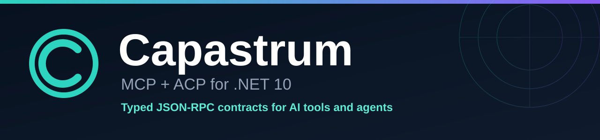

<p align="center">
  <a href="docs/README.md">
    
  </a>
</p>

# Capastrum - MCP + ACP for .NET

<p align="center">🌐 <b>English</b> · <a href="README.ru.md">Русский</a></p>

[](https://github.com/jrfrigat/Capastrum/actions/workflows/ci.yml)
[](https://www.nuget.org/packages?q=Capastrum)
[](https://dotnet.microsoft.com/)
[](https://modelcontextprotocol.io/)
[](https://agentclientprotocol.com/)
[](LICENSE)

Capastrum is the **Swiss army knife for C# developers who work with AI models and agents**. Seven independent NuGet packages implement the **Model Context Protocol 2026-07-28** and the **Agent Client Protocol v1** as strictly typed JSON-RPC 2.0 contracts. Build an MCP server, connect to someone else's, launch and supervise an ACP agent, or expose your application as one - without adopting a framework, an agent runtime or a logging engine.

**A tool, not a framework.** Every package does one job and stays out of your architecture. The application keeps its own dependency injection, configuration, logging and lifetime; Capastrum provides the protocol layer and nothing more.

**Complete in both directions.** MCP server and client, ACP host and agent, with typed requests, results and notifications, subscriptions, cancellation and the human-in-the-loop flows that make them usable in production.

**Fast by construction.** `System.Text.Json` source generation, `System.IO.Pipelines` framing and allocation-conscious hot paths keep the protocol layer out of the way.

**7 packages - MCP server + client - ACP host + agent - stdio / WebSocket / HTTP - .NET 10 - MIT**

---

## Features

- **Full MCP 2026-07-28 coverage** - `server/discover`, tools, resources, resource templates, prompts, completion, subscriptions, sampling, roots and elicitation
- **Full ACP v1 coverage** - initialize and authentication, sessions, prompts, session updates, permissions, file system, terminals, elicitation and cancellation
- **Both directions of each protocol** - serve tools with `Capastrum.Mcp`, consume external servers with `Capastrum.Mcp.Client`, orchestrate agents with `Capastrum.Acp`, expose your own agent with `Capastrum.Acp.Server`
- **Human-in-the-loop by default** - an ACP host that registers no permission handler denies every tool action instead of silently allowing it
- **Typed contracts end to end** - generated JSON serializers, records and enums for every protocol shape; application-defined payloads stay as `JsonElement`
- **Three transports** - newline-delimited JSON over stdio, WebSocket text frames and HTTP POST with MCP protocol headers
- **MRTR built in** - a tool can return `input_required`; the client resolves sampling, roots or elicitation and retries with the handler's state intact
- **Subscriptions and notifications** - filtered `subscriptions/listen` streams for tool, resource and prompt changes
- **Independent packages** - reference only the layer you need; `Capastrum.JsonRpc` has no dependency outside the base class library
- **Verified end to end** - conformance tests cover each protocol surface and a full ACP host -> agent -> MCP client -> MCP server chain
- **Benchmarked hot paths** - BenchmarkDotNet suites for envelopes, peer round trips and MCP tool dispatch

---

## Quick start

Pick the packages for the side of the protocol you need:

| You are building | Install |
| --- | --- |
| An MCP server | `Capastrum.Mcp` |
| An MCP client | `Capastrum.Mcp.Client` |
| An ACP host that drives an agent | `Capastrum.Acp` |
| An ACP agent | `Capastrum.Acp.Server` |

```sh
dotnet add package Capastrum.Mcp
dotnet add package Capastrum.Mcp.Client
dotnet add package Capastrum.Acp
dotnet add package Capastrum.Acp.Server
```

### MCP server

```csharp
using Capastrum.Mcp;
using Capastrum.Mcp.Protocol;

var server = new McpServer(new McpServerOptions
{
    Name = "Capastrum-Tools",
    Version = "1.0.0",
});

server.RegisterTool(
    "echo",
    "Echoes a value",
    (context, _) => ValueTask.FromResult<McpResult>(
        McpToolResult.Text(context.Arguments.GetProperty("value").GetString() ?? string.Empty)));

await server.RunAsync(Console.OpenStandardInput(), Console.OpenStandardOutput());
```

`McpServer` also registers resources, resource templates and prompts, handles `server/discover`, serves HTTP through `HandleHttpRequestAsync` and sends filtered change notifications through `NotifyToolsChangedAsync`, `NotifyResourcesChangedAsync` and `NotifyPromptsChangedAsync`.

### MCP client

```csharp
using System.Text.Json;
using Capastrum.Mcp.Client;

await using var client = await McpClient.ConnectAsync(new StdioMcpClientOptions
{
    Command = "my-mcp-server",
});

var tools = await client.ListToolsAsync();
var result = await client.CallToolAsync(
    "echo",
    JsonSerializer.SerializeToElement(new { value = "hello" }));
```

The client performs `server/discover` on connect and resolves multi-round-trip requests through the `SamplingHandler`, `RootsHandler` and `ElicitationHandler` options. Use `HttpMcpClientOptions` for an HTTP endpoint.

### ACP host

```csharp
using Capastrum.Acp;
using Capastrum.Acp.Protocol;

await using var agent = await AcpAgentClient.StartAsync(new AcpClientOptions
{
    Executable = "npx",
    Arguments = ["-y", "@zed-industries/claude-code-acp"],
    WorkspaceRoot = "/path/to/project",
});

agent.OnSessionUpdate(update => Console.WriteLine(update.Text));
agent.OnActionConfirm((request, _) => ValueTask.FromResult(
    request.Command?.Contains("rm -rf", StringComparison.Ordinal) == true
        ? ConfirmationResult.Denied
        : ConfirmationResult.Allowed));

var session = await agent.NewSessionAsync("/path/to/project");
await agent.SendPromptAsync(
    session.SessionId,
    [new AcpTextContent { Text = "Find outdated dependencies and update them." }]);
```

`OnActionConfirm` is the security boundary: inspect every terminal command and file edit before it runs. File access and elicitation handlers are registered the same way with `OnReadTextFile`, `OnWriteTextFile` and `OnElicitation`.

### ACP agent

```csharp
using Capastrum.Acp.Protocol;
using Capastrum.Acp.Server;

var server = new AcpAgentServer(new AcpAgentServerOptions
{
    AgentInfo = new AcpImplementation { Name = "MyAgent", Version = "1.0.0" },
    NewSessionHandler = (_, _) => ValueTask.FromResult(new AcpNewSessionResponse
    {
        SessionId = Guid.NewGuid().ToString("N"),
    }),
    PromptHandler = async (context, cancellationToken) =>
    {
        await context.SendUpdateAsync(
            new AcpAgentMessageChunk
            {
                Content = new AcpTextContent { Text = "Hello from C#." },
            },
            cancellationToken);

        return new AcpPromptResponse { StopReason = AcpStopReason.EndTurn };
    },
});

await server.RunAsync(Console.OpenStandardInput(), Console.OpenStandardOutput());
```

Inside a prompt turn, `AcpPromptContext` provides `SendUpdateAsync`, `RequestPermissionAsync`, structured terminal access, file system access and `ElicitAsync`.

---

## Packages

| Package | Responsibility | Depends on |
| --- | --- | --- |
| `Capastrum.JsonRpc` | JSON-RPC 2.0 peer, message model, transports | - |
| `Capastrum.Mcp.Protocol` | MCP 2026-07-28 contracts and serializer | `Capastrum.JsonRpc` |
| `Capastrum.Mcp` | MCP server: tools, resources, prompts, HTTP | `Capastrum.Mcp.Protocol` |
| `Capastrum.Mcp.Client` | MCP client: stdio, WebSocket and HTTP | `Capastrum.Mcp.Protocol` |
| `Capastrum.Acp.Protocol` | ACP v1 contracts and serializer | `Capastrum.JsonRpc` |
| `Capastrum.Acp` | ACP host: process launch, permissions, files, terminals | `Capastrum.Acp.Protocol` |
| `Capastrum.Acp.Server` | ACP agent server | `Capastrum.Acp.Protocol` |

Every package is published separately. There is no umbrella package, so an application never carries a protocol implementation it does not use.

---

## Architecture

Dependencies point in one direction, and the two protocols never reference each other:

```text
Capastrum.JsonRpc
├── Capastrum.Mcp.Protocol ── Capastrum.Mcp
│                          └─ Capastrum.Mcp.Client
└── Capastrum.Acp.Protocol ── Capastrum.Acp
                           └─ Capastrum.Acp.Server
```

`Capastrum.JsonRpc` owns the envelope, request correlation, cancellation and stream framing. Protocol packages turn JSON-RPC parameters into typed records and back through source-generated `JsonSerializerContext` instances. The server, client, host and agent packages contain only protocol behavior; they do not start a dependency injection container, configure logging or own the application's lifetime.

MCP is implemented as a stateless core: `server/discover` negotiates the version and capabilities, `_meta` carries protocol metadata, tool results use `resultType`, and multi-round-trip requests are expressed as `input_required` results. ACP uses the v1 stdio model with explicit permission requests, so the host decides what an agent may execute and write.

The full design is in [docs/en/architecture.md](docs/en/architecture.md).

---

## Build and test

```sh
dotnet build Capastrum.sln -c Release
dotnet test Capastrum.sln -c Release
dotnet pack Capastrum.sln -c Release -o artifacts/packages
pwsh ./eng/verify-packages.ps1
```

Run the benchmarks:

```sh
dotnet run -c Release --project benchmarks/Capastrum.Benchmarks -- --filter "*"
```

CI builds, tests, packs and verifies all seven packages on every push and pull request.

Contributor workflow, branch and commit conventions: [CONTRIBUTING.md](CONTRIBUTING.md).

---

## Requirements

- .NET SDK 10; the repository pins `10.0.401` in `global.json`.
- No runtime dependency outside the base class library for `Capastrum.JsonRpc`; every other package references only the package beneath it.

---

## Documentation

All documentation lives in **[docs/](docs/README.md)**, in English and Russian.

| Document | Languages | Description |
| --- | --- | --- |
| [README.md](README.md) - [ru](README.ru.md) | EN - RU | Project overview and quick start |
| [JSON-RPC core](docs/en/json-rpc.md) - [ru](docs/ru/json-rpc.md) | EN - RU | Envelope, peer, transports, errors, performance |
| [MCP](docs/en/mcp.md) - [ru](docs/ru/mcp.md) | EN - RU | Server, client, MRTR, subscriptions, HTTP |
| [ACP](docs/en/acp.md) - [ru](docs/ru/acp.md) | EN - RU | Host, agent, permissions, files, terminals |
| [Architecture](docs/en/architecture.md) - [ru](docs/ru/architecture.md) | EN - RU | Package graph, protocol layering, design decisions |

---

## License

MIT (c) 2026 FrigaT
